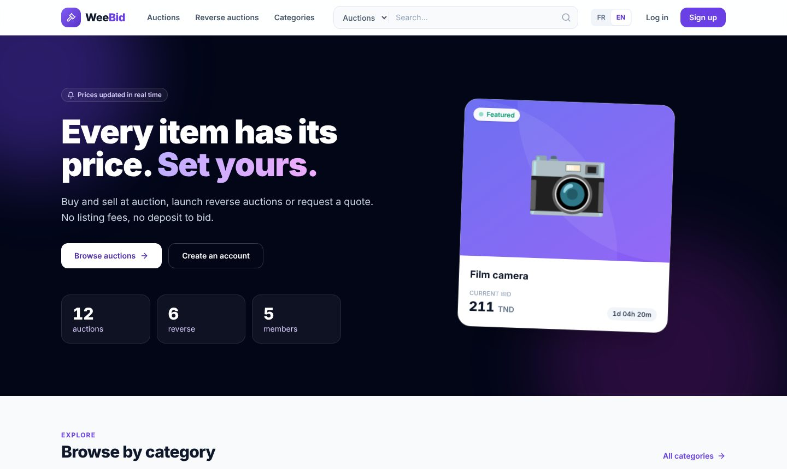
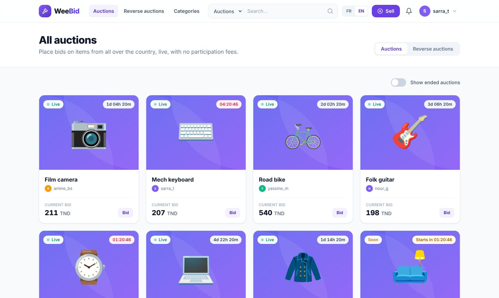
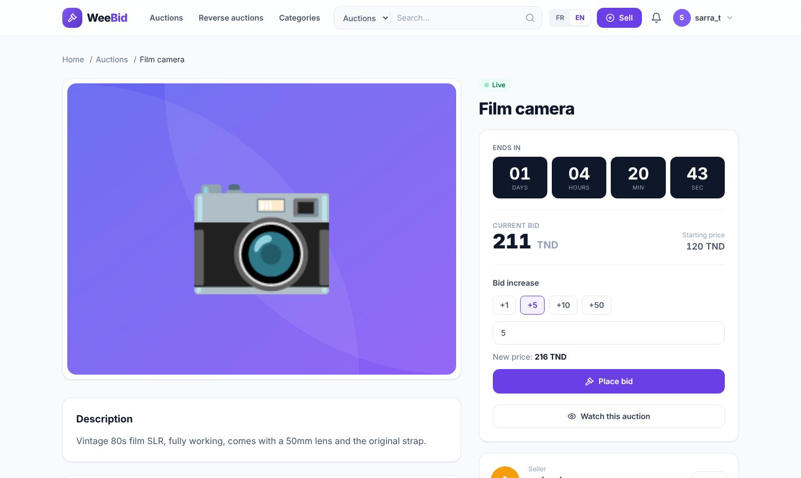
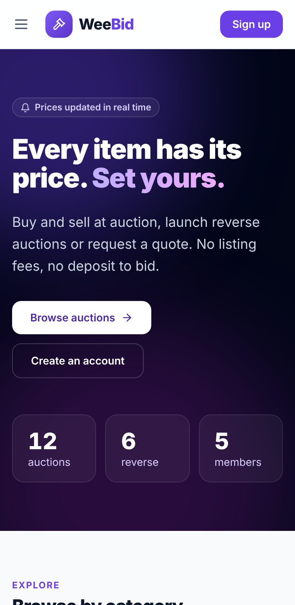
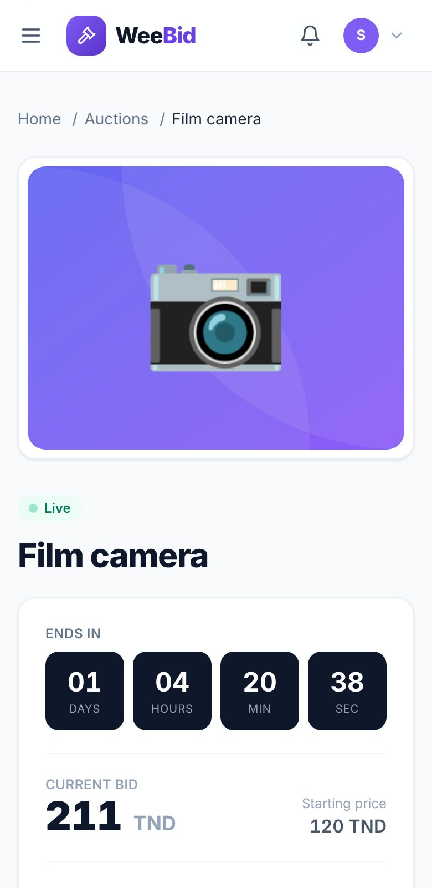

<div align="center">

# WeeBid — online auction marketplace

**Buy, sell and negotiate through live auctions, reverse auctions and quote requests.**
My first full-stack web project: React · Symfony · Node.js (Socket.io) · MariaDB



</div>

## The idea

WeeBid is a marketplace where people compete over a product by bidding for the best price, whatever the product is.
I wanted to remove what makes classic auction sites annoying:

- **Free to use**: no listing fee and no deposit to bid.
- **Flexible timing**: the seller freely chooses when the auction starts and how long it lasts.
- **Reverse auctions**: a buyer posts a need and sellers compete by *lowering* their price. The lowest offer wins.

It started as my end-of-studies project: about 3–4 months of work, plus a 40-page report (in French). It was my first real step into web development.

## Main features

- **Auctions** with live countdown, bid history and a seller dashboard (close, edit dates, manage bids).
- **Reverse auctions** and **quote requests / proposals** between members.
- **Real-time prices and notifications** pushed to every open browser with Socket.io.
- **Watch list**: follow an auction and get notified on every new bid.
- **Accounts**: sign up, JWT authentication, editable profile, public member pages.
- **Search and browsing** by category, member or keyword, with pagination.
- **Photo uploads** for listings and an **admin dashboard** (EasyAdmin) to manage all the data.
- **Responsive**, available in **French and English**.

<table>
  <tr>
    <td></td>
    <td></td>
  </tr>
  <tr>
    <td align="center"></td>
    <td align="center"></td>
  </tr>
</table>

## Tech stack

| | |
|---|---|
| **Frontend** | React 17, Redux, React Router, Formik, Axios, Tailwind CSS, i18next |
| **Backend** | Symfony 5.4, API Platform, Doctrine ORM, JWT (Lexik), EasyAdmin |
| **Real-time** | Node.js + Socket.io |
| **Database** | MariaDB / MySQL |

```
 Browser (React) ──► Symfony REST API ──► MariaDB
        │                    ▲
        └── Socket.io ──► Node server (verifies bids, creates notifications)
```

## What was updated with Claude

The application itself (concept, data model, API, real-time features) is my original work. I recently used [Claude](https://claude.ai/code) to modernise how it looks and who can use it:

- **A complete UI redesign with Tailwind CSS**: new design system (colours, typography, components), a responsive layout from phone to desktop, a new homepage, auction cards, auction page, forms, profile and tables, plus loading and empty states.
- **Cleaner frontend code**: one shared component for all auction listings and one for auction pages, instead of many near-identical copies.
- **French / English translation** with i18next: language switcher in the navbar, remembered choice, and numbers and dates formatted for the selected language.

## Installation

### Quick start with Docker (recommended)

You need [Docker](https://docs.docker.com/get-docker/) with the Compose plugin.

```bash
git clone https://github.com/AhmedJguirim/WeeBid-Auctions-marketplace.git
cd WeeBid-Auctions-marketplace
cp .env.example .env
docker compose up -d --build
```

The first start takes a few minutes. Then open:

- **The app:** http://localhost:18080
- **Admin dashboard:** http://localhost:18000/admin (`admin@weebid.local` / `admin1234`)
- **Demo members** (the database is filled with sample auctions): `amine@weebid.local`, `sarra@weebid.local`… with password `demo1234`

Putting it on a server, updates and backups: see [DOCKER.md](DOCKER.md).

### Manual setup (for development)

Requirements: PHP 8.1, Composer, Node 18+, MariaDB or MySQL.

```bash
# 1. Backend (http://127.0.0.1:8000)
cd backend
composer install
#   set DATABASE_URL in backend/.env.local, then:
php bin/console doctrine:database:create
php bin/console doctrine:schema:update --force
php bin/console lexik:jwt:generate-keypair
php bin/console app:create-admin you@example.com a-strong-password
php bin/console app:seed-demo                # optional sample data
php -S 127.0.0.1:8000 -t public              # or: symfony server:start

# 2. Real-time server (port 8081)
cd ../socket && npm install
#   notifications are created through a plain member account:
#   (backend) php bin/console app:create-admin socket@weebid.internal <password> --role=ROLE_USER --display-name=weebidsocket
SOCKET_PASSWORD=<password> npm start

# 3. Frontend (http://localhost:3000)
cd .. && npm install --legacy-peer-deps && npm start
```

## Project structure

```
src/        React app (components, redux, i18n/locales)
backend/    Symfony API, entities, admin dashboard
socket/     Socket.io server
docker/     nginx config      scripts/   deployment helpers
```

## Contributing

Contributions, bug reports and ideas are welcome.

1. Fork the repo and create a branch: `git checkout -b feature/my-idea`.
2. Run the app locally (see above) and keep the style of the surrounding code.
3. Make sure `npm run build` passes. Add every new UI text to **both** `src/i18n/locales/fr.json` and `en.json`.
4. Commit with a short, clear message and open a pull request describing what changed and why.

## Contact

**Ahmed Jguirim** · jguirimahmed112@gmail.com · [GitHub](https://github.com/AhmedJguirim)
